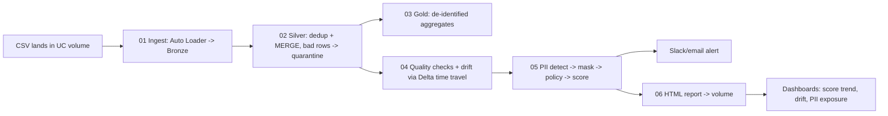

# ComplianceLens

Event-driven healthcare data compliance automation on **Databricks (Free Edition)**.

When a new patient data file lands in a Unity Catalog volume, a Databricks Workflow runs:
**ingest → dedup/MERGE → quality checks → schema-drift detection → PII detection →
policy-driven action (mask / quarantine / block) → compliance score → alert → HTML report → dashboard.**

All data is **synthetic**. Compliance output is **indicative engineering signal only —
not legal advice, not a certification.**

## Architecture



Automation loop: **Trigger → Detect → Decide → Act → Notify → Report**

## Repository layout
```
compliancelens/
├── config/                  # policy.yaml, controls.yaml, score_weights.yaml
├── data_gen/                # synthetic generator + defect injector + drop simulator
├── src/compliancelens/      # importable package (unit-testable without Spark)
│   ├── ingestion/           # Auto Loader -> Bronze (cloudFiles, availableNow)
│   ├── transform/           # Silver MERGE + quarantine, Gold aggregates
│   ├── quality/             # checks.py, drift.py (pure Python)
│   ├── pii/                 # validators (Verhoeff Aadhaar), detector, masking
│   ├── policy/              # YAML rule engine -> actions
│   ├── compliance/          # indicative controls mapping + transparent scoring
│   ├── audit/               # run_id helper, audit log (Delta or JSONL)
│   └── alerts/              # Slack webhook + SMTP fallback, HTML report
├── notebooks/               # 00_setup.sql, 01..06 thin Databricks entry points
├── scripts/evaluate_pii.py  # precision/recall vs ground truth (real runs only)
├── tests/                   # 37 pytest tests + zero-dep local runner
├── dashboards/queries.sql   # Databricks SQL tiles
├── workflow/compliancelens_workflow.json
└── .github/workflows/ci.yml # ruff + pytest on push/PR
```

## Why these design decisions
- **Delta MERGE, not overwrite:** re-running a batch or a late correction never duplicates a patient — idempotent by construction.
- **Delta time travel for drift:** `DESCRIBE HISTORY` + `VERSION AS OF` gives old-vs-new schema for free; plain Parquet can't. Drift classified: column_added=low, type_changed=high, column_removed=critical.
- **Quarantine, never silent drops:** rows failing casts go to `silver.quarantine` with a reason (DPDP Act S.8(3) accuracy, GDPR Art. 5(1)(d)).
- **YAML policy engine without `eval`:** auditable plain rules, validation errors that name the exact rule and key.
- **Pure-Python core:** checks, drift, detector, policy and scoring run without Spark, so they are unit-testable locally and in CI.
- **Explainable PII detection:** column-name hints + regex + Verhoeff checksum (Aadhaar) + match-ratio threshold; every flag carries `confidence` and `method`.

## Free Edition checklist (verify in your workspace, fallbacks included)
- [ ] Serverless compute + Auto Loader (`cloudFiles`) → fallback: scheduled job with `trigger(availableNow=True)` (implemented)
- [ ] File-arrival trigger on the volume → fallback: 5-min Workflow schedule (implemented in `workflow/compliancelens_workflow.json`)
- [ ] Unity Catalog volumes → fallback: DBFS paths (`/dbfs/FileStore/...`)
- [ ] Column masks → fallback: in-pipeline masking + masking views (implemented)
- [ ] System tables → fallback: own `audit.audit_log` Delta table (implemented)
- [ ] Slack webhook → fallback: SMTP email (`alerts/notify.py`)

## Quickstart
```bash
pip install -r requirements.txt

# 1. Generate 3 synthetic batches (1 clean, 2 adds blood_group, 3 drifts age->text, drops insurance_id)
PYTHONPATH=src python data_gen/generate.py --patients 200

# 2. Unit tests (zero-dep runner; CI uses pytest)
python tests/run_local.py        # or: pytest -q

# 3. Measure PII detector accuracy against ground truth
python scripts/evaluate_pii.py

# 4. Databricks: run notebooks/00_setup.sql, then create the job from
#    workflow/compliancelens_workflow.json pointing at notebooks/01..06.

# Live demo: drop a fresh random-defect file into the landing volume
PYTHONPATH=src python data_gen/simulator.py --landing /Volumes/compliancelens/landing/patients
```

## Measured results (real runs, reproducible via the commands above)
| Metric | Value | Source |
|---|---|---|
| Unit tests | **35 passed / 0 failed** (2 pytest-fixture tests run only on CI) | `python tests/run_local.py` |
| PII detector, batch 1 (302 patients) | **P = 1.00, R = 1.00, F1 = 1.00** for aadhaar, email, phone; 614 PII elements, 0 FP, 0 FN | `python scripts/evaluate_pii.py` |
| Aadhaar detection | 8/8 found with **0 false positives** — Verhoeff checksum rejects regex-clean fakes | same run |
| Compliance score | run notebook 05 and paste before/after from `audit.compliance_scores` | your workspace |
| Idempotency | re-run tasks 01–02 twice; silver row count must be identical | your workspace |

Honest caveats: the phone regex (`[6-9]xxxxxxxxx`) deliberately misses landline-style
10-digit numbers starting 0–5 (accepted FN trade-off), and free-text precision will drop
on notes containing other 10-digit numbers (order IDs etc.) — batch 1 had none. Aadhaar
stays FP-free because the checksum, not the regex, makes the final call.

Never hardcode metrics — every number in a fork of this repo must come from an actual run.

## What is automated vs what needs a human
- **Automated:** detection (quality, drift, PII), masking, quarantine, scoring, alerts, reports.
- **Human:** approving policy changes, investigating critical drift, legal interpretation. ComplianceLens flags; it does not certify.

## Limitations & future work
The `patients` vertical slice is fully wired end-to-end; the other tables are generated
with defects but their silver/gold stages follow the same copyable pattern. The masking
salt must come from Databricks secrets, never the repo.

Future work: Presidio, Great Expectations, MLflow, dbt, Delta Live Tables, Asset Bundles, Kafka.

## Disclaimer
Indicative engineering signals only — **not legal advice, not a DPDP/GDPR compliance certification.**
